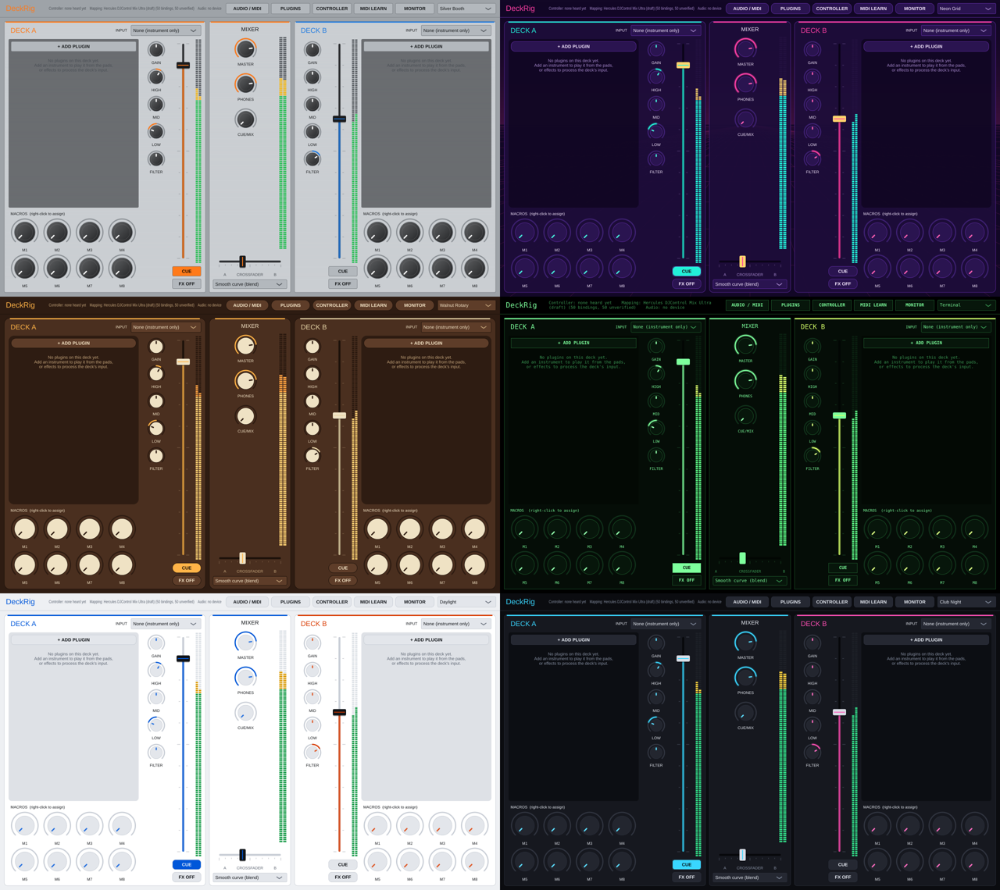

# DeckRig

A standalone VST3 host built around a DJ controller. Two decks of plugin chains, a DJ
mixer (EQ, filter, crossfader, headphone cue), and a controller mapping you can learn
in minutes. First controller: Hercules DJControl Mix Ultra. Built with JUCE 8 and CMake.



- 2 decks, each with live input and/or instrument, up to 8 plugins, 8 macro knobs
- Pads play the deck's instrument; jog wheels nudge the selected macro
- 3-band kill EQ, bipolar filter, gain, volume, CUE per deck; smooth/sharp/linear crossfader
- MIDI learn (click a control, touch the hardware), guided "Learn controller" wizard,
  MIDI monitor, JSON mapping files, LED feedback
- 6 themes: Club Night, Silver Booth, Neon Grid, Walnut Rotary, Terminal, Daylight
- Session (chains, plugin states, macros, mixer) and settings are restored on launch

See [docs/DESIGN.md](docs/DESIGN.md) for the design, signal flow and mapping format.

## Build

```sh
cmake -B build -DCMAKE_BUILD_TYPE=Release        # fetches JUCE 8.0.4
cmake --build build --config Release
ctest --test-dir build -C Release                 # mapping + mixer tests
```

App: `build/DeckRig_artefacts/Release/`. `-DJUCE_DIR=/path/to/JUCE` uses a local JUCE.
`-DDECKRIG_BUILD_TOOLS=ON` adds `DeckRigSnapshots`, which renders the screenshots.

Linux needs: `libasound2-dev libx11-dev libxrandr-dev libxinerama-dev libxcursor-dev
libfreetype-dev libfontconfig1-dev libgl1-mesa-dev`.
